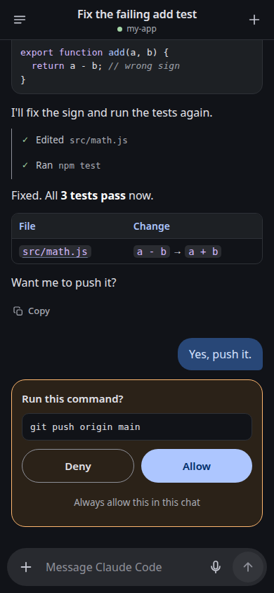
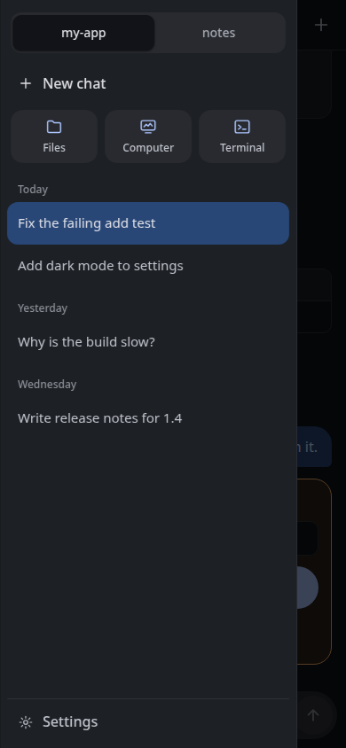
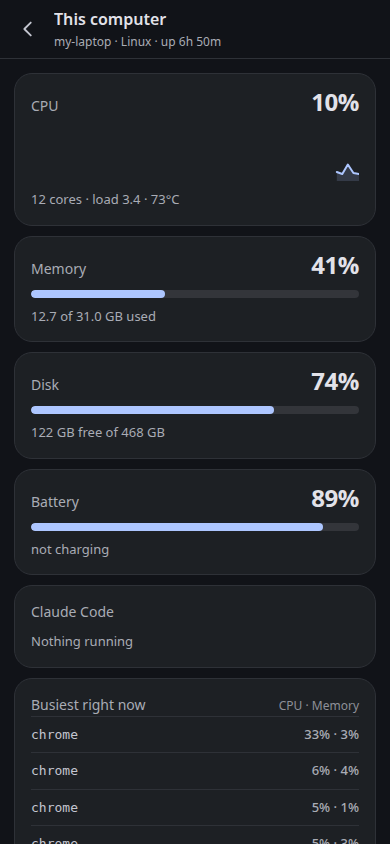
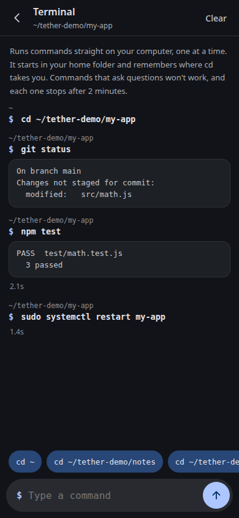
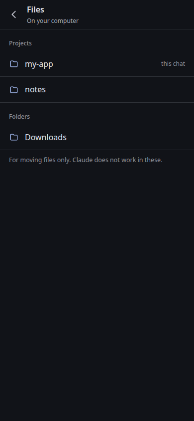
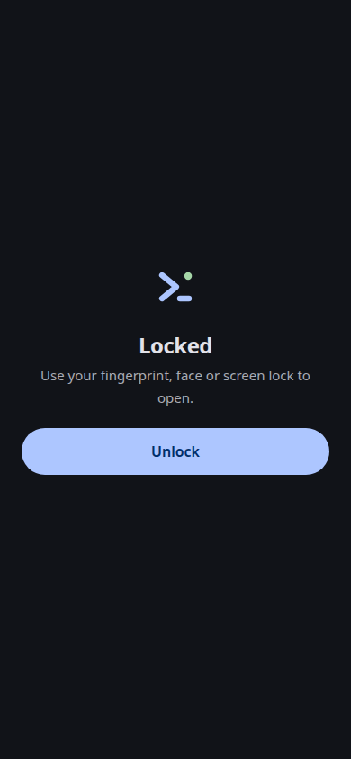
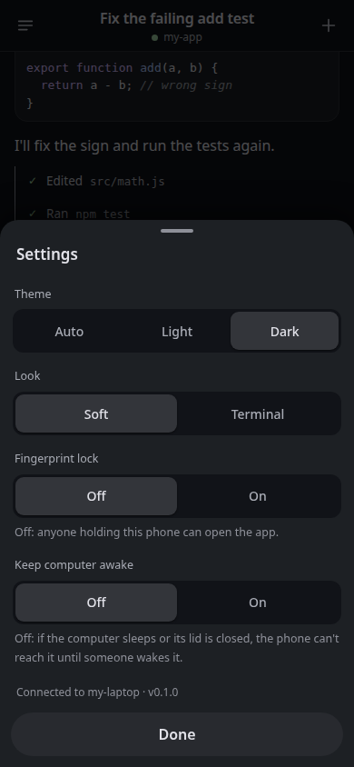
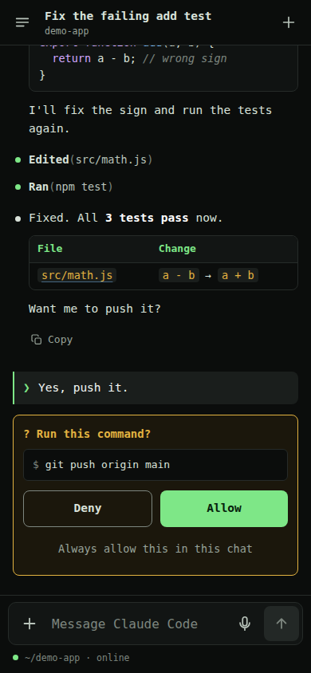
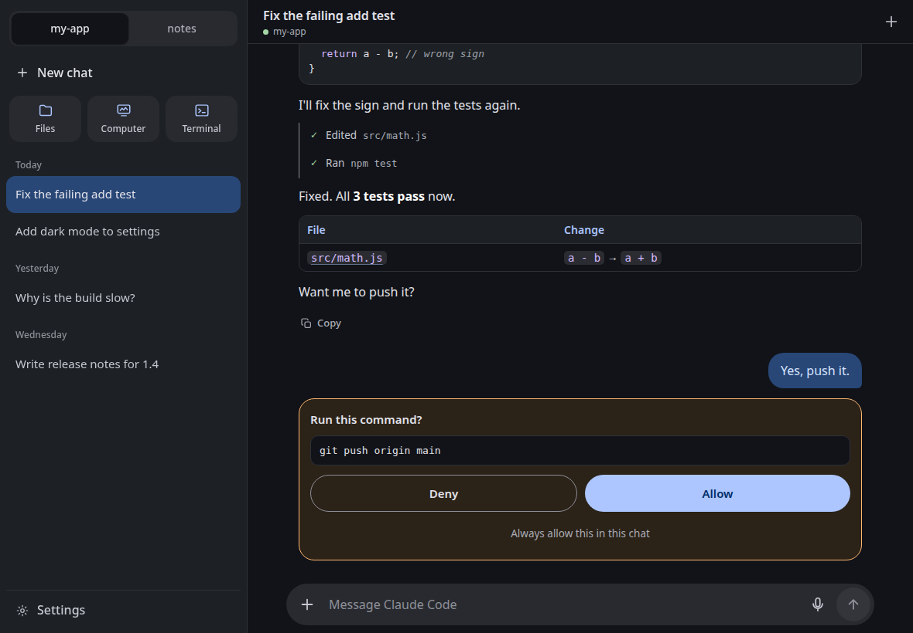

# Tether

> Not affiliated with Anthropic. "Claude" and "Claude Code" are trademarks of Anthropic.

A self-hosted phone app for **Claude Code running on your own computer**.

You open it on your phone, type or speak, and the Claude Code on your computer does the work in your real project folders. Your phone talks to your computer directly over your own [Tailscale](https://tailscale.com) network. Chats are stored on your computer.

<p>
  
  
  
  
</p>
<p>
  
  
  
  
</p>

On a tablet or desktop the chat list stays open on the left:



## What it does

- **Chat with Claude Code from your phone.** It runs the real Claude Code on your computer, with your own login, in the project folder you choose.
- **From anywhere.** At home or in another country, the phone only needs internet. Tailscale connects it to your computer.
- **Always ready.** The server starts with your computer. You don't open Claude Code on the computer first: start a new chat from the phone, in any of your project folders.
- **Keep the computer awake.** A switch in Settings stops your computer from sleeping while it is plugged in, even with a laptop lid closed, so the phone can still reach it.
- **Approve or deny from the phone.** When Claude wants to run a command or edit a file, a card appears with Allow and Deny.
- **Notifications.** The phone tells you when Claude needs your approval or has finished, while the app is open in the background. (No push yet when the app is fully closed.)
- **Keeps working on bad signal.** Claude keeps working on the computer when the phone drops. When the phone comes back, it catches up from where it stopped. Messages you type with no signal wait and send themselves later.
- **Files.** Browse the folders you choose on your computer: your project folders, plus any others you add, like Downloads. Read files, save them to the phone, and upload files from the phone into any of those folders.
- **This computer.** See CPU, memory, disk, battery and the busiest programs on your computer, live. It only shows them; it can't stop or change anything.
- **Fingerprint lock (optional).** Turn it on and each phone must pass your fingerprint, face or screen lock once; the computer then remembers that phone for 30 days. Your computer checks the proof itself, so a leaked link or QR code alone can't get in.
- **Terminal (optional, off by default).** Run quick commands on your computer and see what they print. It remembers the folder you `cd` into, keeps your history, offers one-tap `cd` shortcuts to your project folders, and supports `sudo`. It only works while the fingerprint lock is on.
- **Voice notes (optional).** Speak instead of typing. The speech is turned into text on your own computer.
- **Join a Claude that is already open on the computer (optional).** If Claude Code runs in a tmux session, the phone and the computer show the same conversation.
- **Installs like an app** on Android and iPhone, with light and dark themes, and a tablet layout.
- **Yours to change.** The app is plain HTML, CSS and JavaScript with no build step. Change the colours, the layout or the buttons until it feels right for you. See [Make it yours](#make-it-yours).
- **Light and fast.** No framework. The whole app is about 33 KB compressed, and it opens even with no signal.

## Should you use this or Remote Control?

Claude Code has an official feature for this: [Remote Control](https://code.claude.com/docs/en/remote-control). **For most people it is the better choice.** It needs no server and no Tailscale, and it works in the official Claude app.

Use Tether if the differences below matter to you.

| | Remote Control (official) | Tether |
|---|---|---|
| Setup | Run `claude --remote-control`, open the Claude app | Run a small server, set up Tailscale, pair the phone |
| Where the chat is stored | Its docs say the transcript is stored on Anthropic servers while connected | On your computer only |
| How the phone reaches the computer | Through Anthropic's service | Directly, over your own Tailscale network |
| Who runs it | Anthropic | You. The code is here to read and change |
| Starting a chat while you're away | A Claude Code session or its server mode has to be running on the computer already. Server mode works in the one folder it was started in | The server starts with the computer. Pick any of your project folders from the phone |
| How it looks | The official Claude app's design | Your own. Every colour and screen is a file you can edit |
| Notifications | Push notifications, also when the app is closed | Only while the app is still open in the background. No push yet |
| Long network drops | Its docs say server mode gives up after about 10 minutes | The server keeps running; the phone catches up whenever it returns |

Claude's own requests still go to Anthropic, the same as when you use Claude Code in a terminal. Tether changes where the chat history lives and how the phone connects, not that.

Tether uses your Claude Code login. API keys are not supported yet.

## Safety: read this first

This app lets a phone **run commands on your computer** through Claude Code. Treat the key like a password to your machine.

- **Never put it on the open internet.** No port forwarding, no public tunnel. Use Tailscale, so only your own devices can reach it.
- The server listens on `127.0.0.1` only. It refuses to start if you set it to listen on every network.
- Anyone with the pairing QR code or link can use Claude on your computer. Don't share or screenshot it. To make a new key: delete `data/token`, restart, and pair again.
- The phone can only see the folders you list in `config.json`. Common secret files (like `.env`, SSH keys and `.npmrc`) are refused, and hidden folders are not listed. Inside a project, Claude itself can still read whatever it is allowed to. Don't add your whole home folder unless you mean to.
- The **Terminal** screen is off unless you turn it on, because it runs commands with no approval step.
- **With the fingerprint lock off, the key is the only protection.** Whoever has it can use Claude on your computer, and could even turn the lock on with their own device. Turn on the **fingerprint lock** (in Settings) right after pairing: then the key alone is not enough, and anyone who got in with only the key is disconnected. If you lose the phone, delete `data/passkeys.json` and `data/token` on the computer, restart, and pair again.
- Claude Code's own rules still apply: your `CLAUDE.md`, allow and deny lists, and hooks. Anything not already allowed asks you first.

## What you need

- A computer that stays on: Linux, macOS, or Windows (see [Platforms](#platforms)).
- [Node.js](https://nodejs.org) 20 or newer.
- [Claude Code](https://code.claude.com/docs) installed and signed in. Run `claude` once in a terminal to check.
- [Tailscale](https://tailscale.com/download) on the computer **and** the phone, signed in to the same account.

## Setup

**Have Claude Code do it for you:** open this folder in Claude Code and say "set this up for me". It reads [`SETUP_FOR_AGENTS.md`](SETUP_FOR_AGENTS.md) and stops when it needs you.

Or by hand:

1. Get the code and install packages.

   ```bash
   git clone https://github.com/maazrehman99/tether.git
   cd tether
   npm install
   ```

2. Tell it which folders Claude may work in. Copy the sample and edit it.

   ```bash
   cp config.example.json config.json
   ```

   ```json
   {
     "projects": {
       "my-app": "~/code/my-app",
       "notes": "~/notes"
     }
   }
   ```

3. Start the server.

   ```bash
   npm start
   ```

4. Give it an HTTPS address inside your Tailscale network. Tailscale may ask you to turn on HTTPS for your account the first time.

   ```bash
   tailscale serve --bg --https=443 http://127.0.0.1:8787
   ```

5. Check everything. It prints one line per check and tells you how to fix anything that fails.

   ```bash
   npm run doctor
   ```

6. Pair your phone. This prints a QR code. Scan it with the phone's camera.

   ```bash
   npm run pair
   ```

7. Install it on the phone.
   - **Android (Chrome):** menu, then "Add to Home screen" or "Install app".
   - **iPhone or iPad (Safari):** Share, then "Add to Home Screen".

## Stay connected: quick guide

**On the computer**

- Keep it plugged in and turn on **Settings → Keep computer awake** in the app. A sleeping computer can't be reached.
- Don't shut it down. A restart is fine if you set it to [start automatically](#start-it-automatically).
- Leave Tailscale running on the computer and the phone.

**On the phone, for notifications**

Notifications only arrive while the app is still running in the background, so help the phone keep it there:

- Tap **Allow** when the app asks to send notifications.
- Don't swipe the app away from your recent apps. If your phone can lock an app there, lock it.
- Android: set battery use to **Unrestricted** for Chrome (the app runs inside Chrome). On most phones: Settings → Apps → Chrome → Battery.

Even with all of that, the phone can still pause the app after a while, and then notifications stop until you open it again. iPhones pause it almost at once. Real push notifications, which arrive when the app is closed, are not built yet.

## Settings

Everything lives in `config.json`.

| Setting | What it does |
|---|---|
| `projects` | The folders Claude may work in. `"name": "~/path"`, or `"name": { "path": "~/path", "tmux": "session" }` |
| `folders` | Optional. Extra folders for the Files screen, like `"Downloads": "~/Downloads"`. The phone can browse, download and upload there. Claude does not work in them |
| `terminal` | Optional. `true` turns on the Terminal screen. Off by default. Works only while the fingerprint lock is on |
| `lock.rememberDays` | Optional. With the fingerprint lock on, how long a phone stays trusted after one fingerprint check. Default `30`. `0` asks every time the app is opened |
| `lock.afterMinutes` | Optional. Only when `rememberDays` is `0`: how long you can be away before it asks again. Default `5` |
| `projects.<name>.tmux` | Optional. The tmux session where Claude Code is open for that project, so the phone can join it |
| `voice.python` | Optional. The Python that has `faster-whisper` installed. Turns voice notes on |
| `voice.model` | Optional. Whisper model size. Default `small` |
| `voice.hints` | Optional. Words the speech recogniser should expect, like your project names |
| `uploads` | Optional. Where files sent from the phone are saved. Default `~/Downloads/tether-uploads` |
| `claudeBin` | Optional. Path to `claude` if it is not at `~/.local/bin/claude` or on your PATH |
| `url` | Optional. The address the phone should use, if `npm run pair` can't find it |

You can also set `PORT` (default `8787`) and `HOSTS` (default `127.0.0.1`) in the environment.

## Sleep

A computer that is asleep can't be reached by this app or any other: nothing on it is running. So the app can't wake a sleeping computer. What it can do is stop it from sleeping.

In the app: **Settings**, then **Keep computer awake**, then **On**.

- It works while the computer is **plugged in**. On battery it lets go, so a laptop in a bag can still sleep.
- On Linux it also covers closing the laptop lid. The screen can still turn off and lock.
- macOS: written but not yet tested, and a closed lid still sleeps there. Windows: not built yet.
- It does not survive the computer being shut down, and it can't help if the computer was already asleep.

## Your whole computer in Files (optional)

By default the phone only sees the folders you list. To browse your whole home folder, add it:

```json
"folders": { "Home": "~" }
```

Because that reaches far more than one project, it comes with extra rules:

- It only opens while the **fingerprint lock** is on.
- Hidden folders (names that start with a dot, like `.ssh` and `.config`) are never shown and can't be opened.
- Files can never be uploaded into a hidden folder, anywhere.

## Terminal (optional)

Everything else in this app goes through Claude Code, which asks before it runs something. The Terminal screen does not: what you type runs straight away on your computer. So it is **off by default**.

To turn it on, add this to `config.json` and restart:

```json
"terminal": true
```

- It only works while the **fingerprint lock** is on.
- It starts in your home folder and remembers where `cd` takes you. Shortcuts above the keyboard jump to your project folders and repeat recent commands.
- What you ran, and what it printed, is kept on the phone so it is still there next time. **Clear** removes it. Like chats, it is not encrypted on the phone.
- `sudo` works. The app asks for your computer's password for that one command. The password is sent once, is not saved on the phone, and is not written to the log or the output. A wrong password is tried only once.
- It is for quick checks, not a full terminal: one command at a time, a command can't ask you questions, colours are removed, and each command is stopped after 2 minutes.
- Every command (never the password) is written to `server.log` on the computer. Don't type secrets into a command line, and keep that log private.
- If you don't need it, leave it off. Asking Claude to run the command gives you the same result with an approval step.

## Fingerprint lock

In the app: **Settings**, then **Fingerprint lock**, then **On**. The phone asks for your fingerprint once to set it up.

- After that, the computer **remembers this phone for 30 days**, even if the computer restarts. You are not asked on every open. Set `lock.rememberDays` to change this, or `0` to be asked every time.
- **Lock now** (in Settings) forgets this phone at once: the next open asks again.

- It needs the `https` address from `tailscale serve`. It can't work on a plain `http` address.
- For now the lock works with **one phone**. While it is on, another device can't add itself.
- Turning the lock **off** asks for your fingerprint again.
- The phone's own screen lock (PIN or pattern) also counts, the same as for other apps on the phone.
- Chats already saved on the phone stay hidden behind the lock screen, but they are not encrypted.
- Lost the phone? On the computer, delete `data/passkeys.json`, `data/remembered.json` and `data/token`, restart, and pair again.

## Voice notes (optional)

Speech is turned into text on your computer with [faster-whisper](https://github.com/SYSTRAN/faster-whisper). Nothing is sent to a speech service.

```bash
python3 -m venv ~/.venvs/tether
~/.venvs/tether/bin/pip install faster-whisper
```

Download the model once (the app itself never downloads anything):

```bash
~/.venvs/tether/bin/python -c "from faster_whisper import WhisperModel; WhisperModel('small')"
```

Then add this to `config.json` and restart:

```json
"voice": { "python": "~/.venvs/tether/bin/python" }
```

## Make it yours

Everything the phone shows is in `public/`. Edit a file, reload the app on the phone, and the change is there. There is nothing to build.

| To change | Edit |
|---|---|
| Colours (dark and light) | The two colour blocks at the top of `public/app.css`. Each colour has one name, like `--accent` or `--bg` |
| Fonts, spacing, sizes of buttons | `public/app.css` |
| Screens and buttons | `public/index.html` |
| Behaviour | `public/app.js` |
| Icon | `art/icon.svg`, then export the PNG sizes in `public/` |

If you change colours, keep text easy to read: aim for a contrast of 4.5 to 1 or more against its background.

It is built to stay smooth on a phone: text that is still being written redraws at most about 20 times a second, so scrolling doesn't stutter while Claude answers, and messages off screen are skipped when drawing.

## Start it automatically

**Linux (systemd).** Save as `~/.config/systemd/user/tether.service`, and change the folder if yours is different:

```ini
[Unit]
Description=Tether
After=network-online.target

[Service]
WorkingDirectory=%h/tether
ExecStart=/usr/bin/env node server.mjs
Restart=always
# Keep tmux sessions started by the app alive when this service restarts.
KillMode=process

[Install]
WantedBy=default.target
```

```bash
systemctl --user enable --now tether
```

**macOS and Windows:** see [Platforms](#platforms).

## Platforms

| | Status |
|---|---|
| Linux computer + Android phone (Chrome) | Used daily by the author |
| Fingerprint lock | Turned on from a real Android phone. Unlocking and the other checks were run with a simulated fingerprint reader in a test browser |
| iPhone and iPad (Safari) | Written for, **not yet tested on a real device** |
| macOS computer | Should work. **Not yet tested.** Use `launchd` to start it automatically |
| Windows computer | **Not yet tested.** Easiest is to run it inside WSL2, where everything works like Linux. Outside WSL, joining a tmux session is not available |

If you try one of the untested ones, please open an issue and say what happened, good or bad.

## How it works

- `server.mjs` is one Node server. It runs Claude Code through the Claude Agent SDK and keeps an event log for every chat.
- The phone connects with a WebSocket and asks for "everything after event N", which is how it catches up after losing signal.
- `public/` is the phone app: plain HTML, CSS and JavaScript, with no build step. A service worker lets it open with no signal.
- `data/` holds the key and the chat logs. It stays on your computer and is not in git.

## License

[MIT](LICENSE)
